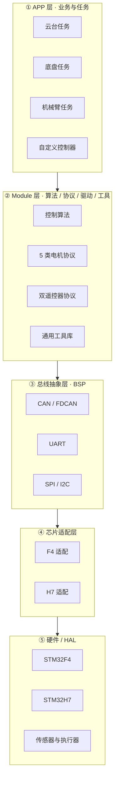
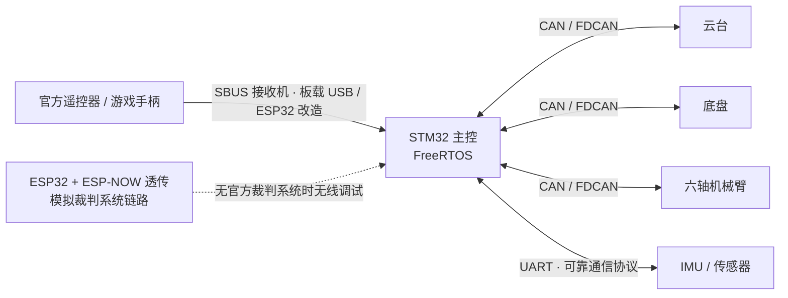

<h3>Hi, I'm Moo-YY 👋</h3>

<b>嵌入式软件 / RoboMaster</b> · 南昌大学 Passion 战队电控

<i>聚焦 STM32 实时控制、多传感器融合与跨机型嵌入式架构设计</i>

本页所列项目源码因战队代码管理要求暂未公开，此处展示架构设计、模块划分与工程化实践。

---

## 🛠 Tech Stack

---

## 🧭 当前在做

| 方向 | 内容 |
| :--- | :--- |
| **整车电控** | 云台 / 底盘 / 六轴机械臂 / 自定义控制器 的实时控制与模块间通信 |
| **通信可靠性** | bxCAN 邮箱满丢帧、遥控断流的队列调度与中断补帧机制 |
| **工程化** | 4 台机器 10 个工程从 Keil 迁移到 CMake 多仓五层架构 |

---

## 🏗 系统架构

### 跨机型五层软件架构

> 业务代码不出现任何芯片头文件；硬件差异由总线抽象层与芯片适配层吸收，F4 / H7 按需链接同一套复用层。

### 整车通信拓扑

> 矢量版架构图（可用于简历 / 答辩）：[docs/architecture.svg](docs/architecture.svg)

---

## 📊 工程数据

| 指标 | 说明 |
| :--- | :--- |
| **4 台机器 / 10 个工程** | 复用层覆盖范围，Git 多仓按需链接 |
| **5 类电机协议 + 双遥控器** | 在 F4 / H7 平台零改动复用 |
| **144 组同名文件** | SHA256 扫描比对，用于确定收敛顺序 |
| **20+ 逐字节相同文件** | 零重构迁移至公共模块 |
| **双档 CI 门禁** | SIL 回归 + 分层依赖检查 |

---

## 🚀 Featured Projects

### ① RoboMaster 机器人电控系统设计与控制算法研究 2025.10 — 至今

负责战队英雄 / 重装 / 轮腿等机器人**整车电控**研发，统筹云台、底盘、机械臂、自定义控制器的实时控制与模块间通信。

- **实时通信**：基于 STM32 + FreeRTOS，以 CAN / FDCAN / UART 组建整车通信网络；针对 **bxCAN 邮箱满丢帧**与**遥控断流**，设计双路队列、中断补帧与两级超时衰减机制，实现丢帧归零与稳定通信；开发串口可靠通信协议。
- **无线调试链路**：自研 ESP32 + ESP-NOW 透传链路模拟裁判系统，无官方裁判系统时仍可无线调试。
- **遥控器通用化**：完成游戏手柄板载 USB 接入，并基于 ESP32 改造 **SBUS 通用接收机**。
- **控制算法**：基于 MIT 协议实现六轴机械臂力矩闭环，采用牛顿-欧拉法推导并实现重力补偿；独立设计基于 IMU 反馈的主动摇臂悬挂平衡控制；熟悉五连杆轮腿建模、VMC 解算与 LQR 控制。

### ② 跨机型嵌入式基础软件层与自动化质量体系 2026.09 — 至今

采用 Git 多仓架构，为 4 台机器 10 个工程建立跨机型复用层，覆盖**算法 / 协议 / 驱动 / 工具**四类模块，供 F4 / H7 平台按需链接。

- **架构升级**：主导旧版 Keil 工程向 CMake 多仓五层架构迁移；以总线抽象与芯片适配层隔离硬件差异，实现业务层零芯片头文件。
- **收敛方法**：以 SHA256 扫描 144 组同名文件确定收敛顺序，零重构迁移 20+ 逐字节相同文件。
- **质量体系**：建立基于 Git 工作流触发的 SIL 回归、分层依赖检查与双档 CI 质量门禁。

以上项目源码均未公开，说明见下节。

---

## 🔒 关于代码公开

> 本页所列项目源码因 RoboMaster 战队代码管理要求暂不公开；这里仅展示架构设计、模块划分与工程化实践。面试或技术交流时，可提供架构设计文档、目录结构、构建脚本与核心代码片段供讲解。

完整说明、简历写法与面试话术见 [docs/code-availability.md](docs/code-availability.md)。

---

## 📫 联系

可通过简历所载邮箱联系，也欢迎在本仓库开 Issue 交流嵌入式工程化与机器人控制。
